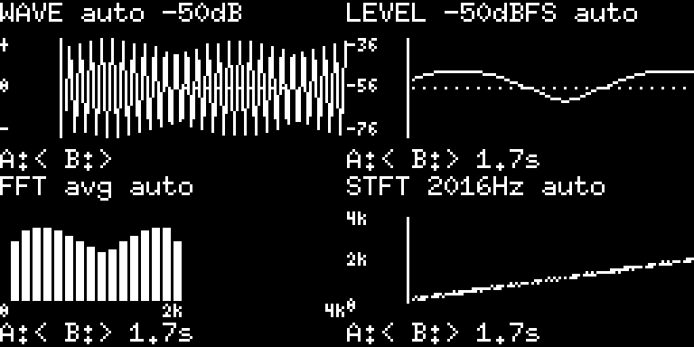

# micro-view-audio

Live microphone plots on a **micro:bit V2** and **Kitronik VIEW Graphics128**.
Slot the micro:bit into the VIEW and connect a USB data cable. The onboard
microphone supplies the audio; no additional sensor or jumper wires are needed.



The preview uses a synthetic tone. The firmware captures the real microphone.

## Build and flash

From the workspace root:

```sh
cargo build-view-audio --profile firmware
cargo flash-view-audio -- --profile firmware
```

From this directory:

```sh
cargo build --profile firmware
cargo embed -- --profile firmware
```

The target is `thumbv7em-none-eabihf`. The `firmware` profile enables optimization
while keeping debugging information. The flash command uses the onboard debug
probe and opens RTT output.

## Controls and modes

**A goes backwards; B goes forwards.** Both wrap around this sequence.
**Touch the gold micro:bit logo** to cycle history duration:
**1.7 → 3.3 → 6.7 → 13.3 seconds**, then back to 1.7 seconds. The selected
duration appears in the Level, FFT and Spectrogram footers. Waveform is live
and has no duration readout.

| Mode | What the screen shows | Try this |
| --- | --- | --- |
| Waveform | About 13 ms of DC-centered audio, with automatic vertical scaling | Hum and watch the shape change |
| Level | RMS level history with an automatically adjusted vertical scale | Clap or speak louder and watch the trace rise |
| FFT | 32 frequency bars from 0 to just below 4 kHz, averaged over the selected duration | Whistle or play a steady tone and watch its average build |
| Spectrogram | Frequency vertically, time horizontally; more white pixels indicate stronger energy; the header shows the latest strongest FFT bin | Slide a whistle up and down and look for a sloping trace |

The newest history is at the right. Histories keep updating in every mode, so
switching to the spectrogram immediately reveals the recent sound. Changing
duration clears the histories and FFT average, then starts a fresh time axis.
The average builds from the completed groups available so far. Latest
instantaneous readings are retained; Waveform remains a live view. The duration
controls Level and Spectrogram history and the FFT averaging period.

The waveform scales itself to the current signal. Its height therefore does
not measure loudness: use Level for comparisons. `dBFS` is relative to the ADC
range, with 0 dBFS representing full-scale AC amplitude. It is **not calibrated
dB SPL**. Smaller negative values indicate stronger signals. The microphone
uses gain 4 and a VDD/4 reference, giving a VDD/16 input range (about 0.19 V at
a 3 V supply), following the micro:bit runtime's microphone settings. The
14-bit ADC uses four-conversion burst averaging per 8 kHz sample; the analysis
uses 8,192 counts as the full-scale AC amplitude.

All plots mark their automatic scaling with `auto`. Waveform expands even
signals of a few ADC counts. Level fits its axis to the **whole visible history**,
with 4 dB of padding where the -100 to 0 dBFS limits allow it. Its range is at
least 40 dB and widens for larger changes, keeping both loud and quiet sounds
on screen. The range contracts when old extremes leave the history; the header
and axis labels retain actual dBFS values. FFT bars use a 40 dB range with 6 dB
of headroom above the strongest averaged band, following the current average
directly. Spectrogram brightness uses the same range and headroom above the
latest strongest component, with a reference that rises immediately for louder
sounds and returns towards quieter sounds gradually (about 0.3 s time constant).
These scales can also make microphone background noise visible. Spectrogram
brightness represents strength within the changing automatic scale; use Level
to compare absolute ADC-relative levels across time.

## FFT and the moving window

Audio is sampled at **8,000 samples/second**. A **512-sample periodic Hann
window** spans **64 ms**, producing FFT bins **15.625 Hz** apart. Each new
128-sample block advances the window **16 ms**, keeping **75% overlap**. The
first spectrum appears after one complete window.

Each display bar groups eight FFT bins into a **125 Hz band**. For every FFT
result, it takes the strongest component's linear power within each band,
then averages those powers over the selected duration before converting to
dB for display. The `FFT avg auto` header marks this averaged, automatically
scaled view. It has no instantaneous peak-frequency readout. The Spectrogram
header's frequency comes from the latest strongest individual FFT bin. It is
a dominant-component readout, rather than a pitch estimator. DC and the exact
Nyquist endpoint are omitted.

The histories and FFT average retain **104 groups**. At the shortest duration
each group contains one FFT result. Longer durations combine **2, 4 or 8 results
per group**. The FFT average updates after each complete group: every
**16, 32, 64 or 128 ms**, respectively. During startup, after changing duration,
or after a capture gap, it averages only the completed groups available so far.
The first bars appear once the first group is complete.

For Level and Spectrogram, each group becomes a history column, preserving the
peak RMS level and the strongest automatically scaled value in each band.
The exact spans are **1.664, 3.328, 6.656 and 13.312 seconds**. Combining peaks
keeps short claps and brief tones visible in those histories at longer durations;
the FFT bars show their contribution to the average instead.

Low frequencies are at the bottom, high frequencies at the top. Because the
OLED is monochrome, a repeating dot pattern represents the automatically
scaled strength; equal strengths have equal density at every frequency row. The display
refreshes at up to 20 frames/second, while analysis continues for every 16 ms hop.

The 8 kHz sampling rate limits the spectrum to 4 kHz. Higher-frequency sounds
can alias into the visible range. This is a small audio visualization demo.

## Responsive buttons and power-off

The shared [`microbit-input`](../../crates/microbit-input/) crate samples both
buttons every **2 ms** in a timer interrupt, with **6–8 ms debounce**. It queues
presses through FFT calculations and OLED transfers. Holding a button produces
one navigation event; release it before pressing again.

Logo touch sensing uses capacitive charge timing, so a finger on the logo is
sufficient. It runs asynchronously between timer interrupts, samples every
4 ms, and debounces in 12–16 ms. It calibrates ten startup readings; keep the
logo untouched for those first 40 ms. Holding the logo produces one duration
change, and release rearms it. If it was held during startup, stable release
readings restore sensitivity automatically.

Hold the rear reset/power button, then release it to shut down. A short press
wakes/restarts the demo. The [`microbit-power`](../../crates/microbit-power/)
crate checks the startup event before lighting the display. Cleanup stops
button sampling, disconnects the audio sampling timer/PPI routes, waits for
ADC DMA to stop, disables the microphone, and turns the OLED off before the
interface-chip handshake and System OFF transition.

With USB/debugging connected, parts of the board remain powered and System OFF
can be emulated. Disconnect the debugger for a battery-power check. The VIEW
power indicator remains on while its 3V supply is present.

## How it is organized

- [`src/microphone.rs`](src/microphone.rs): hardware-triggered SAADC capture.
- [`src/blocks.rs`](src/blocks.rs): a bounded queue of owned audio blocks.
- [`src/analysis.rs`](src/analysis.rs): DC removal, RMS, Hann window and FFT.
- [`src/view.rs`](src/view.rs): modes, histories and drawing.
- [`src/main.rs`](src/main.rs): hardware setup, navigation, processing and shutdown.

The microphone is on **P0.05 / AIN3**, enabled through the high-drive **P0.20**
pin. TIMER0 and PPI channel 0 trigger an ADC sample every 125 µs. PPI channel 1
starts the next transfer when a block finishes. Two fixed RAM buffers alternate;
the SAADC interrupt copies completed blocks into an eight-block queue. The FFT
and renderer process copies, while capture continues.

The queue allows roughly 128 ms of processing backlog. If the foreground falls
behind, it drops the oldest queued blocks and reports the count through RTT.
A sequence gap clears FFT overlap, plot histories and the FFT average so
disconnected samples do not create a misleading continuous spectrum. Processing
per loop iteration is bounded so navigation and power checks continue to run.

TIMER1 schedules screen refreshes, TIMER2 samples buttons and captures logo
charge time in CC2, and TIMER3 handles the power handshake. The logo is P1.04;
GPIOTE channel 0 and PPI channel 2 timestamp its rising edge. Microphone PPI
channels 0/1 are owned separately. TWIM1 drives the external OLED on P19/P20 at address
`0x3C`; TWIM0 talks to the internal power interface. The FFT average stores
per-group power sums in about 13 KB of fixed RAM. No dynamic allocation is used.
The [`microfft`](https://docs.rs/microfft/0.6.0/microfft/) crate provides the
512-point real FFT.

Avoid stopping at breakpoints during live capture: hardware sampling continues
while interrupt handling is halted. Reset the board before resuming a capture
session. Ordinary FFT processing and I²C transfers leave interrupts enabled.

## Check without hardware

From the workspace root:

```sh
cargo test -p micro-view-audio -p micro-view -p microbit-input --lib
cargo test -p microbit-power --lib --no-default-features
```

The tests cover known tones, relative levels, DC/silence, overlap, capture-queue
overflow and recovery data, mode navigation, all four durations, quiet-signal
scaling, gain recovery, plot bounds, averaging powers before display scaling,
average startup/reset and history expiry, duration readouts, and button/logo
taps queued during foreground work.

Generate a four-mode preview from a synthetic sweeping tone:

```sh
cargo run -p micro-view-audio --example preview > /tmp/micro-view-audio.pgm
```

Run this example from the workspace root to use the host target.

Hardware references:

- [micro:bit V2 microphone pin map](https://tech.microbit.org/hardware/schematic/)
- [micro:bit V2 hardware](https://tech.microbit.org/hardware/2-0-revision/)
- [CODAL microphone ADC gain and sampling configuration](https://raw.githubusercontent.com/lancaster-university/codal-nrf52/master/source/NRF52ADC.cpp)
- [CODAL capacitive touch sensing](https://raw.githubusercontent.com/lancaster-university/codal-nrf52/master/source/NRF52TouchSensor.cpp)
- [Kitronik VIEW documentation](https://kitronik.co.uk/products/56115-kitronik-view-graphics128-oled-display-128x64-for-bbc-micro-bit)
