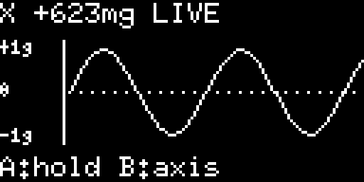

# micro-view

A scrolling accelerometer graph for a **micro:bit V2** and the **Kitronik
:VIEW Graphics128**. Tilt the assembled board to change the trace. No jumper
wires are needed: slot the micro:bit into the VIEW and power it through the
micro:bit's USB connector.



The preview uses synthetic data; the firmware reads the onboard accelerometer.

## Rust support

The VIEW uses a standard SSD1306 controller over I²C. A Kitronik-specific crate
is unnecessary:

| Crate | Purpose |
| --- | --- |
| [`ssd1306` 0.10](https://docs.rs/ssd1306/0.10.0/ssd1306/) | Initialize the OLED and send its framebuffer over I²C |
| [`embedded-graphics` 0.8](https://docs.rs/embedded-graphics/0.8.2/embedded_graphics/) | Draw pixels, lines and text |
| [`lsm303agr` 1.1](https://docs.rs/lsm303agr/1.1.0/lsm303agr/) | Read acceleration in milligravity |
| [`microbit-v2` 0.16](https://docs.rs/microbit-v2/0.16.0/microbit/) | micro:bit peripherals and the nRF52833 HAL |

These versions use `embedded-hal` 1.0, matching this workspace. The display uses
the full **128×64** pixels with a **1,024-byte** framebuffer, without a heap.

## Try it

From the workspace root:

```sh
cargo build-view --profile firmware
cargo flash-view -- --profile firmware
```

The flash command uses the micro:bit's onboard debug probe and opens RTT output.
`cargo-embed` is already used by the other firmware projects. Plug in a USB data
cable and close any other program using the debug probe before flashing.

From this project directory, the equivalent commands are:

```sh
cargo build --profile firmware
cargo embed -- --profile firmware
```

The project config selects `thumbv7em-none-eabihf`; the workspace config supplies
the linker settings. Selecting this package from the workspace root needs the
explicit target, which `build-view` supplies.

## What to do with it

- **Tilt left/right:** watch the X-axis trace rise and fall.
- **A:** pause/resume the trace and displayed reading (`HOLD` / `LIVE`).
- **B:** cycle X → Y → Z, clearing the history for the new axis.
- **Hold the rear reset/power button, then release:** turn off the display and
  enter System OFF. A short press wakes/restarts the demo.

Each graph column represents **100 ms**, giving approximately **10.4 seconds**
of history. The newest point is at the right. The dotted line is zero; the top
and bottom are +1g and −1g. Motion beyond that range clips the trace, while the
numeric reading still shows the measured value. **1,000 mg = 1g**; here `mg`
means milligravity. The accelerometer includes gravity, so turning the board
changes the reading even when it is held still.

Changing axes while paused clears the graph and keeps it paused. Press A to
start collecting the new axis. The buttons are sampled every **2 ms** by a
timer interrupt and settle after **6–8 ms** of consistent readings. Presses
remain queued while the main loop sends a frame to the OLED, so a quick tap does
not need to last through the screen update. Holding a button produces one action;
release it before pressing again. A and B are tracked independently.

Power-off uses the workspace's [`microbit-power`](../../crates/microbit-power/)
helper. It checks the startup reset event before lighting the OLED, stops button
sampling, puts the accelerometer into power-down mode and turns the OLED off.
It then completes the interface-chip handshake and enters System OFF. A USB
debugger keeps some hardware powered and can emulate System OFF; disconnect it
for a battery-power check. The VIEW's power indicator remains lit while its 3V
supply is present.

## How to use the screen

[`src/main.rs`](src/main.rs) owns the hardware. [`src/lib.rs`](src/lib.rs) owns
the graph and screen layout. [`src/input.rs`](src/input.rs) samples the buttons
in the timer handler; [`src/buttons.rs`](src/buttons.rs) debounces and queues
their press events. The key steps for the screen are:

1. Set up the external I²C bus on **P19/SCL** and **P20/SDA**.
2. Create an SSD1306 with the VIEW's **seven-bit address `0x3C`**,
   `DisplaySize128x64` and `DisplayRotation::Rotate0`.
3. Select buffered graphics mode and call `init()` once.
4. Clear the buffer, draw into it, then call **`flush()`** to update the screen.

For example, after creating `display_bus` as in `main.rs`, this draws a label
and a line:

```rust
use embedded_graphics::{
    mono_font::{ascii::FONT_6X10, MonoTextStyle},
    pixelcolor::BinaryColor,
    prelude::*,
    primitives::{Line, PrimitiveStyle},
    text::{Baseline, Text},
};
use ssd1306::{I2CDisplayInterface, Ssd1306, prelude::*};

let interface = I2CDisplayInterface::new_custom_address(display_bus, 0x3C);
let mut oled = Ssd1306::new(interface, DisplaySize128x64, DisplayRotation::Rotate0)
    .into_buffered_graphics_mode();

oled.init().unwrap();
oled.clear(BinaryColor::Off).unwrap();

let text_style = MonoTextStyle::new(&FONT_6X10, BinaryColor::On);
Text::with_baseline("Hello VIEW", Point::new(0, 0), text_style, Baseline::Top)
    .draw(&mut oled)
    .unwrap();

Line::new(Point::new(0, 20), Point::new(127, 50))
    .into_styled(PrimitiveStyle::with_stroke(BinaryColor::On, 1))
    .draw(&mut oled)
    .unwrap();

oled.flush().unwrap();
```

Coordinates start at `(0, 0)` in the top-left. X runs from 0 to 127 and Y from
0 to 63, increasing downwards. `BinaryColor::On` lights a pixel; `Off` clears
it. Draw the whole frame before flushing so the display changes together.

The demo converts a sample to a graph row with:

```rust
let y = 32 - acceleration_mg.clamp(-1_000, 1_000) * 18 / 1_000;
```

It joins adjacent samples with `Line`. To plot another source, replace the
accelerometer read in `main.rs` and pass its values to `plot.record`, adjusting
the units and scale in `lib.rs`.

## Hardware details and troubleshooting

micro:bit V2 has **separate internal and external I²C buses**. This demo uses
TWIM1 for the VIEW (nRF pins P0.26/P1.00) and TWIM0 for the onboard sensor and
power-management interface (P0.08/P0.16). It takes the raw peripherals safely
because `microbit-v2` 0.16's `Board` does not retain TWIM1. The sensor and power
helper share TWIM0 through `RefCell` handles; only the main loop accesses this
bus, and transactions leave interrupts enabled. The helper keeps the bus enabled
until the shutdown handshake finishes.

TIMER0 handles sensor configuration delays, TIMER1 schedules graph samples,
TIMER2 samples buttons, and TIMER3 handles the power handshake. The main loop
sleeps between interrupts rather than adding a blocking delay after each frame.

The accelerometer driver expects an **LSM303AGR**. A board with a different
motion sensor needs the matching driver; this firmware does not target
micro:bit V1. The sensor runs at 50 Hz and the graph samples its latest reading
at 10 Hz.

If the screen is blank, check USB power, seating in the edge connector and the
RTT panic message. A VIEW with its address selector changed to display 2 uses
`0x3D`; change `OLED_ADDRESS` in `main.rs` to match. The standard board uses
`0x3C`. If sensor initialization fails, check the motion sensor fitted to the
micro:bit. This small demo reports I²C failures through RTT and halts.

Primary references:

- [Kitronik's VIEW product documentation](https://kitronik.co.uk/products/56115-kitronik-view-graphics128-oled-display-128x64-for-bbc-micro-bit)
- [Kitronik's Python driver and default address](https://github.com/KitronikLtd/micropython-microbit-kitronik-oled/blob/main/ssd1306.py)
- [micro:bit V2 I²C buses](https://tech.microbit.org/hardware/i2c/)
- [micro:bit edge connector pins](https://tech.microbit.org/hardware/edge-connector/)

## Check without hardware

From the workspace root, run the graph and button tests on your computer:

```sh
cargo test -p micro-view --lib
cargo test -p microbit-power --lib --no-default-features
```

The `preview` example renders the actual screen layout using synthetic samples
and writes a 128×64 portable graymap image:

```sh
cargo run -p micro-view --example preview > /tmp/micro-view.pgm
```

Run it from the workspace root so Cargo uses the host target. From inside this
project, add `--target` with your computer's Rust target triple.
